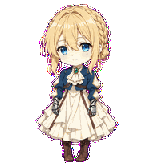

# Violet Evergarden · Desktop Companion

[简体中文](README.md) | English

A chibi animated companion based on Violet Evergarden, with a standalone Windows desktop app and a custom pet package for Codex.



## Download and launch

Download [Violet-Desktop-Pet.zip](https://github.com/amberbrook0104/violet-desktop-pet/releases/download/v1.0.0/Violet-Desktop-Pet.zip), extract it, and open the `desktop` folder. Double-click `Start-Violet.vbs`. If VBScript is unavailable on your computer, use `Start-Violet.cmd`.

The desktop app uses Windows PowerShell 5.1 and WPF, which are included with Windows. It requires no additional runtime, runs offline, and does not add itself to startup.

| Action | Behavior |
| --- | --- |
| Click and drag | Move Violet and play the matching directional animation |
| Click | Wave |
| Double-click | Jump |
| Right-click | Choose an animation, pause, toggle always on top, or exit |
| Press Esc while the pet has focus | Exit |

Position and always-on-top preferences are saved in `desktop/settings.json`. You can move the entire `desktop` folder or create a shortcut to the launcher.

## Use in Codex

Copy both files from `package` into your Codex pet directory:

```text
%USERPROFILE%\.codex\pets\violet-evergarden\
  pet.json
  spritesheet.webp
```

If `CODEX_HOME` is set, use `pets/violet-evergarden` inside that directory instead. Back up any existing pet with the same ID before replacing its files.

In a desktop app that supports local custom pets, open **Settings → Pets → Refresh** and select **薇尔莉特** (Violet). Enter `/pet` to show or hide the floating companion. See the [official pet guide](https://learn.chatgpt.com/docs/pets).

## Animations and files

The sprite atlas is 1536 × 1872 pixels, arranged in 8 columns and 9 rows of 192 × 208 cells. It contains 57 animation frames; unused cells are fully transparent.

| State | Frames | Animation |
| --- | ---: | --- |
| idle | 6 | Quiet breathing and blinking |
| running-right | 8 | Moving right |
| running-left | 8 | Moving left |
| waving | 4 | Greeting wave |
| jumping | 5 | Anticipation, lift, and landing |
| failed | 8 | A subdued, downcast reaction |
| waiting | 6 | Waiting for a response |
| running | 6 | Focused work and hand movements |
| review | 6 | Inspecting and thinking |

The `running` state represents active task work. Directional movement uses the separate `running-right` and `running-left` states.

```text
desktop/             Windows app and PNG sprite atlas
package/             Codex pet manifest and WebP sprite atlas
qa/previews/         GIF previews for all nine states
qa/contact-sheet.png Contact sheet of every animation frame
qa/                  Atlas validation and visual review results
character-spec.json  Character and animation specifications
downloads/           Ready-to-use ZIP package
```

## Validation and customization

All 57 frames were checked for character consistency, movement direction, jump motion, clipping, and transparency. Results are saved in `qa/validation.json` and `qa/visual-qa.json`.

To check that the desktop app can load every frame, run:

```powershell
powershell.exe -NoProfile -ExecutionPolicy Bypass -STA -File .\desktop\VioletPet.ps1 -SelfTest
```

`desktop/VioletPet.ps1` contains the window, interaction, and animation playback logic. Character artwork and animation strips were created with hatch-pet and built-in imagegen. The leftward movement was mirrored frame by frame from the reviewed rightward gait.

When changing the artwork, update both the desktop PNG atlas and the Codex WebP atlas.
